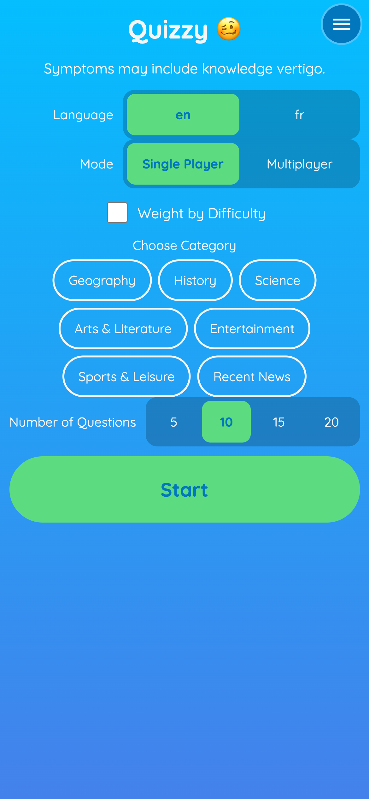
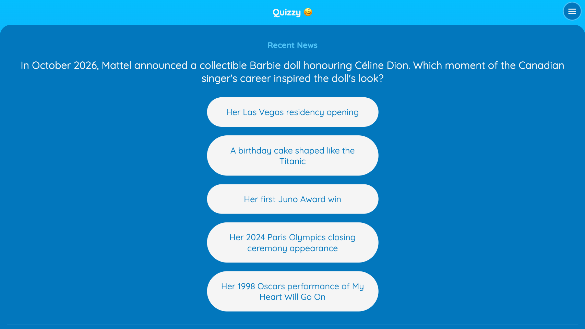
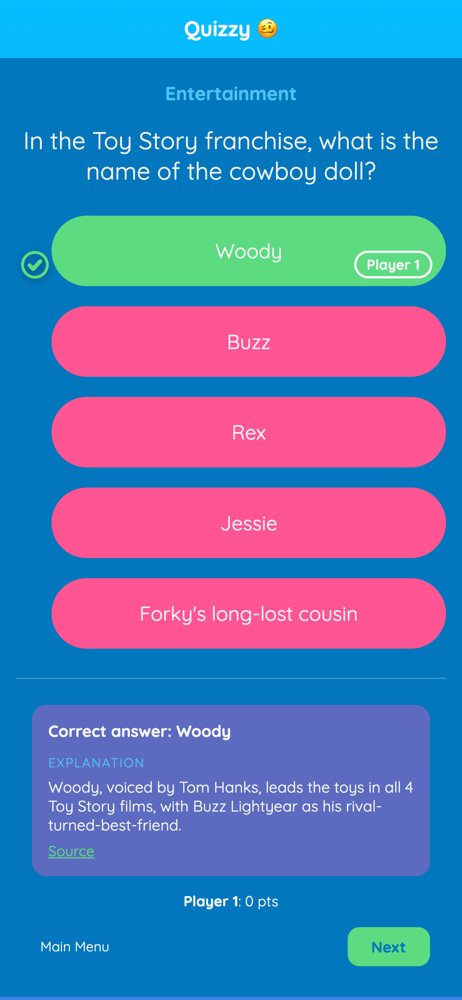
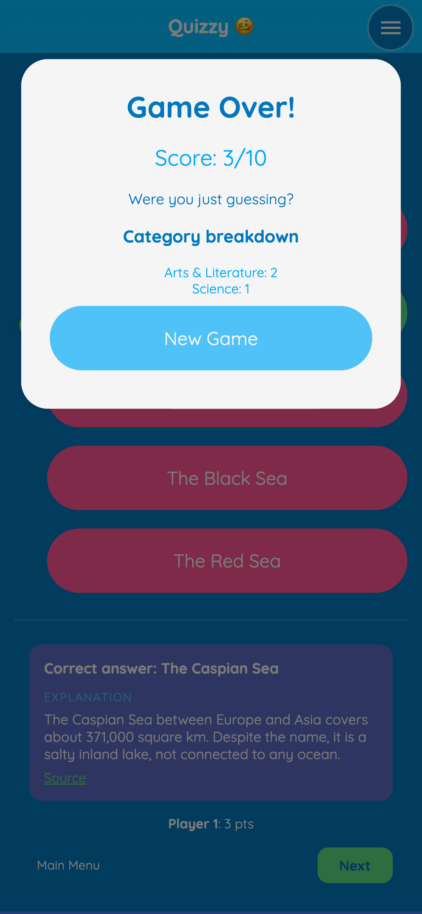

# Quizzy 🥴

A free quiz you can play in your browser — alone, or with a group of friends sharing one device.

**👉 Play it here: [https://erwangranger.github.io/quizzy/](https://erwangranger.github.io/quizzy/)**

No account, nothing to install — open the link and play. It works on phones, tablets, and computers, and it's available in English and French.

---

## What it looks like

Pick how you want to play, then choose a language, a category, and how many questions you want:



Answer multiple-choice questions at your own pace:



After each answer you instantly see whether you were right, along with a short explanation:



When the quiz is over you get your score and a breakdown by category:



## How to play

1. **Choose your mode** — Single Player, or Multiplayer (see below).
2. **Weight by Difficulty** *(optional)* — tick this to make harder questions worth more points. Left off, every question scores the same.
3. **Pick a language** — English (`en`) or French (`fr`).
4. **Pick a category** — Geography, History, Science, Arts & Literature, Entertainment, Sports & Leisure, or Recent News.
5. **Pick how many questions** — 5, 10, 15, or 20.
6. Hit **Start** and answer the questions. Not sure about one? **Skip** it — no penalty, it just moves on.
7. At the end, check your score and start another round, or head back to the menu.

### Playing with friends

Two ways to play together on one device:

- **Pass-and-play** — pass the device around; each player answers on their turn. The strip at the bottom keeps everyone's score.
- **Quizmaster** — one person reads the questions aloud while everyone else writes their answers down. The quizmaster reveals each answer and marks who got it right.
  - Quizmaster-only option: **Hide Choices** — keep answer choices on screen for the quizmaster only, so players answer without seeing the options.

To set up either one, choose **Multiplayer** on the start screen, add each player's name, and pick who (if anyone) is the quizmaster.

## Install it as an app

Quizzy is a progressive web app (PWA): you can add it to your home screen or desktop and it behaves like a regular app — full screen, no browser bars, and it keeps working offline.

- **Chrome/Edge (Android/Desktop):** a banner appears when you visit the site; tap "Add to Quizzy".
- **Safari (iOS):** tap the Share button → "Add to Home Screen".
- **Firefox (Android):** tap the menu (⋮) → "Add to Home Screen" or "Install".

Once installed, Quizzy launches full screen like any other app, with no browser bars. It works offline (the app shell and questions are cached).

## Tips

- The **menu button** in the top-right corner opens an About panel with the app version, install instructions, a link to the source code, and a way to report a problem.
- Quizzy avoids repeating questions until you've seen the whole deck — a message tells you when it starts over.

Quizzy is built with Vue 3, Pinia, TypeScript, Vite and SCSS. Questions live as JSON files in `questions/` — no external API (see the data model in [`docs/SPEC.md`](docs/SPEC.md)). Only questions with `reviewed: true` are bundled into the build; new banks land in `questions/pending/` until reviewed.

```bash
npm install
npm run dev                       # dev server
npm test                          # unit tests
npm run validate:questions        # validate question files
npm run build && npm run preview  # production build + local preview
```
The site deploys to GitHub Pages automatically on every push to `main`.

## Credits

Quizzy started life as a fork of [Christopher Murphy's open-source quiz app](https://github.com/Splode/open-trivia-app) — the original project was the starting point and the inspiration for this one. Credit where credit is due. It has since grown into a new app, going in a new direction of its own.

## License

MIT — see [LICENSE](./LICENSE) (upstream `LICENSE` kept, © 2018 Christopher Murphy).
